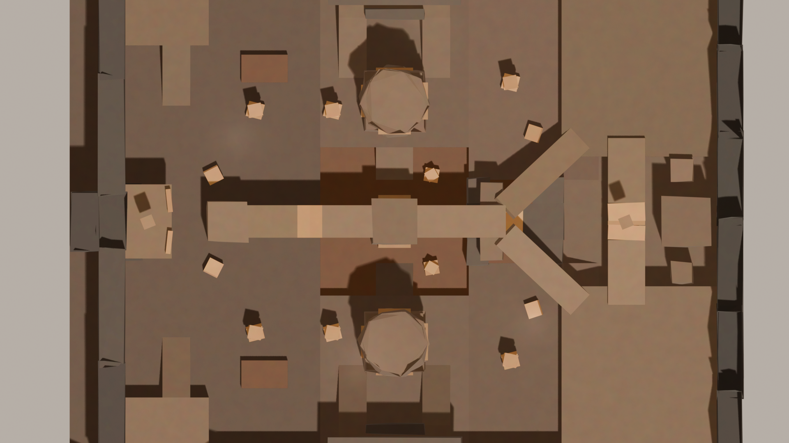
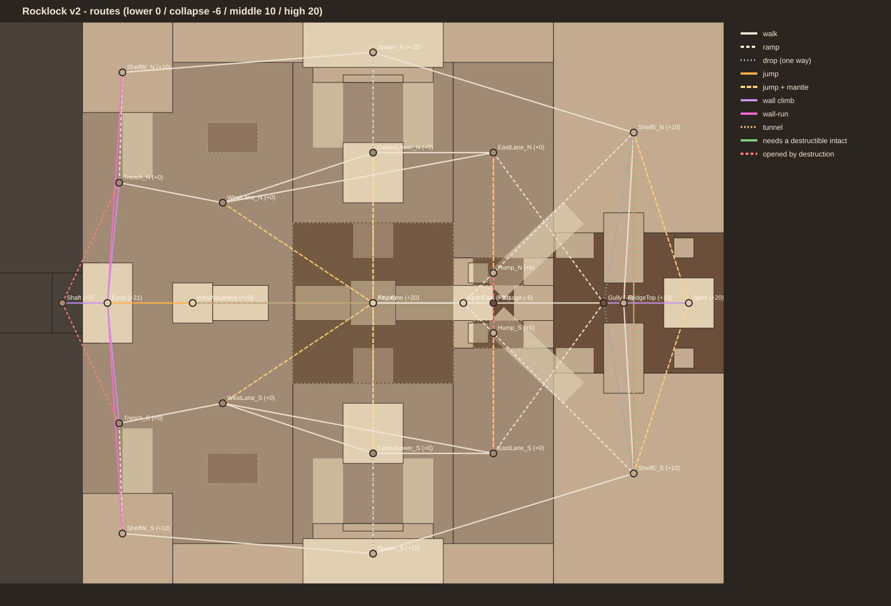
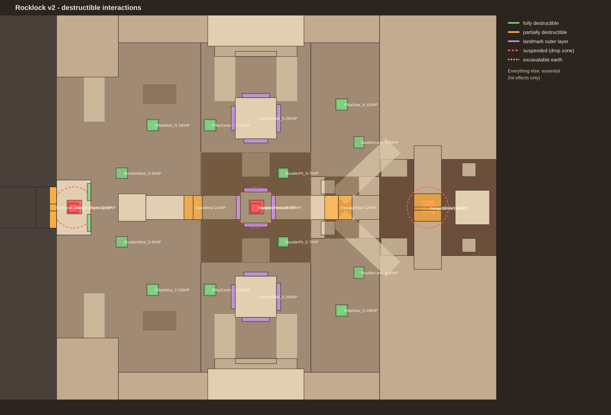

# Rocklock V2 redesign: 1v1 cavern and destructible terrain

Updated: 2026-10-31. **Confirmed:** the owner's "Rocklock V2" brief (complete 1v1 cavern redesign plus a destructible-environment foundation) and its addendum (every attack damages every ordinary destructible; structural health; four categories; anchored large rubble; no mid-round regeneration; exact reset). **Naming:** the brief calls the existing map "v1"; internally that map is Codex's greybox v3 (212.8 × 186.2, `tools/rocklock`, `rocklock.project.json`). It is preserved untouched as the baseline. This redesign lives entirely in new files.

**Implemented and verified offline only.** Studio play and two-client tests have not been run by Claude (the owner's PC froze repeatedly when Studio was driven automatically on 2026-10-30; see [memory note](memory.md)). The owner-run checks are listed at the end.



## Open and play

```powershell
python tools/rocklock_v2/build.py --private      # add --geometry to force new rock skins
python tools/verify_rocklock_v2.py               # offline checks, includes movement/foundation
```

Open `build/SlugshotRocklockV2Private.rbxlx` (Studio account **Jamz4136**, so the blaster loads) and press Play. Without private assets, build without `--private` and open `build/SlugshotRocklockV2.rbxlx`. Never publish or commit these places. Movement, camera, profiles and the blaster are unchanged; slot 1 is the blaster, slot 2 the **Terrain Tester**.

Terrain Tester (temporary, not a slug system): click attacks where you aim · **Z/X/C** weak/medium/heavy (25/55/110 structural) · **V** attack type (Blunt, Penetrating, Tunnelling, Explosive, Elemental) · **F** raises a temporary slab wall (constructive) · **T** resets the round · **Y** runs the self-test (prints `[RocklockV2 SelfTest]` lines to Output and the tester panel). Reset and self-test work only in Studio.

## Layout

**210 × 168 studs.** The first build used the brief's ~140 × 110, but the owner found it "tiny and packed" (2026-10-31), so every horizontal distance grew 1.5×. Tier heights, climb heights, the 12-stud Eyrie jump, the 12-stud broken-bridge gap and the spire steps were kept fixed because they are tuned to the movement. Three tiers measured against the real controller (Athletic: 9.3-stud jump, 14.3 with the double jump, 5.7-stud mantle, 13.6/18.5-stud run/sprint jumps, wall climb 11 studs/s for 3 s): **lower 0** with the sunken **collapse and gully at −6**, **middle 10**, **high 20–21**. Collision is mirror-symmetric north/south so neither spawn is favoured; west and east have different characters.



| Region | Purpose |
| --- | --- |
| **Spawn alcoves** (middle, z ±75) | Recessed under a rock hood. Three exits each: two ramps down, walkways to the west and east shelves. A low front lip and the floor-to-ceiling column block the spawn-to-spawn line. |
| **Monumental columns** (z ±39, 18 studs thick) | Natural pillars screening each spawn from the centre; climbable faces; breakable outer slabs. |
| **The collapse** (centre, −6, 48 × 48) | Sunken fractured floor around the fallen **keystone** monolith. Exits: two ramps, jump+mantle from any side, the lower passage, or a climb up the keystone. Its floor is excavatable earth. |
| **High span** (20) | A 41-stud natural bridge from the west abutment to the keystone top, continuing to the east landing; an 8-stud west section can fall. |
| **West cliff run** | One continuous flat cliff face (x = −87), about 45 studs of wall-run for reliable wall-running from either west shelf to the **Eyrie** (21), a jutting ledge overlooking the centre. Risk: exposed run, predictable landing, a suspended rock above, breakable lip cover. Escape: drop, wall-run on, or a 12-stud jump to the abutment. |
| **Cliff shaft** | A sealed fissure under the Eyrie, between its two support legs. Break the seal and climb the shaft to flank the Eyrie from behind. |
| **East shelves** (middle) | Accessible stone shelves joined by a natural bridge (12) over the gully; stepping stones up to the **Spire** (20). Fallen ceiling slabs ramp from the shelves up to the high span. |
| **Lower passage** (−6) | Short protected route from the collapse through the Hump to the gully. Its roof can be broken from above and its earth side walls dug through, so it cannot be held indefinitely. |
| **West lane** | Main lower flank: progressive cover pillars, loose boulders and diggable earth mounds. |

Movement chains (designed, not yet playtested): wall-run → climb → mantle onto the Eyrie → jump to the abutment → cross the span → slide down a fallen slab; slide through the collapse into the passage → gully → spire steps; drop from the bridge into the gully to shake a pursuer; break the seal and climb the shaft for a surprise Eyrie push.

## Destruction system



**Architecture (hybrid, server-authoritative).** Structures are native anchored chunk parts whose visible shape *is* their collision, so collision always matches the visible damage state. Rock masses use Blender skins over simple essential collision proxies, so wall-running and mantling stay reliable. Loose-earth zones use Roblox Terrain, filled by the server at run time over protected bedrock, so craters and tunnels are real and replicate automatically but can never reach a bottomless hole or breach the boundary. EditableMesh was rejected: clients refuse it in unpublished places (confirmed in this project on 2026-10-30) and it has strict client memory budgets. Per-triangle mesh destruction and runtime CSG were rejected for cost and networking.

| Category (addendum) | Here | Behaviour |
| --- | --- | --- |
| Fully destructible | Pillars, boulders, Eyrie lip | Break completely in stages |
| Partially destructible | Bridge centre, span section, passage roof, shaft seal, hanging formations | Sections fall; the surrounding structure stays |
| Protected landmark | Column and keystone shells | Outer slabs break; the core is essential collision and never goes |
| Essential | Boundary, floors, bedrock, cliff, shelves, ramps, spawns, cores | Hit effects only |

**Damage rules** (`experiments/rocklock-v2/shared/DestructionConfig.luau`, all tunable): dealt = tier damage × material multiplier for the attack type, never below 0.25×, so every attack can break every ordinary destructible. Example: a 100-HP hanging rock falls to one heavy blunt hit (110 × 1.2) or four weak elemental hits (25 × 0.6 each). Materials: Stone, Loose (weak), Slab (thin; penetrating ×1.6), Hardrock (landmark shells; resist penetrating and tunnelling). Explosive hits splash (radius 7, falloff to 40%) and dig. Crossing each stage threshold (HP fractions) breaks that stage's chunks: small ones vanish while clients show debris; large ones topple outward and settle as anchored rubble that stays all round. Rubble never becomes solid inside a player (it waits until clear). The large-rubble cap is 80.

**Suspended formations:** at zero HP, a 1.3 s warning (shake, falling dust, rumble, a pulsing ring on the landing zone), then a server-driven fall. Players within 9 studs of the landing take 45 damage (server-checked). The impact deals 90 blunt structural damage nearby (it can drop the east bridge it lands on), and the rock stays as cover. More power means fewer hits, never a shorter warning.

**Safeguards:** clients send only an aim direction, tier and type; the server raycasts from the player's own head, and only registered destructible chunks and Terrain-zone earth can change. Requests are rate-limited (8/s, per-tier cooldowns) and digging is capped at 12 carves/s server-wide. Hazards are kept away from spawns, and no destructible sits in an alcove. The route graph is verified with every destructible intact **and** with every destructible destroyed: all regions remain reachable from both spawns, and each spawn keeps three exits. There's no mid-round regeneration; `Destruction.reset()` restores the pristine copy, health, rubble, hazards and Terrain exactly (the round service can call it).

**Extending to more of the map:** any new rock piece joins by being generated as a chunk model with `Health/Stages/Material/Category` attributes. Future slugs call `Destruction.attack(origin, direction, amount, archetype, tier, ignore)` with their own structural damage and archetype.

## Previews (Blender, not Studio captures)

Overview cutaways, player-height and route views and before/after pairs are in [evidence/rocklock-v2](evidence/rocklock-v2/): `01–03` overviews; `04` spawn; `05` collapse (lower); `06` east shelves (middle); `07` Eyrie and `10` Spire (high); `08` wall-run route; `09` lower passage; `11/12` centre, `13/14` east bridge and `15/16` west lane before/after destruction ("after" uses predicted rubble; the game computes real landings). Regenerate with `blender -b --factory-startup -P tools/rocklock_v2/render.py -- docs/evidence/rocklock-v2`.

## Status and honest limits

- **Verified offline** (`tools/verify_rocklock_v2.py`, 105 checks plus movement/foundation suites): strict Luau types, lint and format; route connectivity in both destruction extremes; every route within the controller's limits; destructible data validity; non-zero damage for every type and material; rock skins never above walkable tops or past the wall-run face; byte-identical movement sources; private-asset isolation; v1 and foundation independence; 6,107 parts (the existing map has 6,458).
- **Not yet run:** Studio play, the self-test, two-client sync, performance, real movement through every route (offline checks use simplified jump physics), and both acceptance tests (movement fun; combat decisions). Treat route timings and jump gaps as unverified until played.
- **Visual identity:** the geology is still a blocky greybox (boxes and convex hulls in warm stone). The intended Slugterra-inspired character comes from scale, columns, tiers, the collapse and ceiling light shafts, but it needs an art pass (fractured Blender meshes, strata, rubble dressing) once the layout is accepted. Previews are darker and blockier than Studio will look.
- **Research:** the Rocklock wiki page returned HTTP 402 and the official Slug Arsenal pages failed certificate checks, so neither was read. Search results confirmed Rammstone (Rockhorn, Slabhenge) and Armashelt (Cannonbolt bashes through walls). Rocklock's "tiered elevations and rock columns" and Crystalyd's tunnelling come from the owner's brief, unverified. The archetypes in code are generic roles, not species, and no franchise assets are used.

## Owner playtest checklist

1. Play: wall-run west shelf → Eyrie; jump Eyrie → abutment → span; slide down a fallen slab; the passage → gully → spire; bridge drop. Note anything unreachable, awkward or too easy.
2. Tester: break a pillar in stages; drop each hanging rock on yourself and dodge on the ring; break the bridge centre and cross by sprint jump; break the seal and climb the shaft; dig the collapse floor and the Hump walls; press **T** and check everything returns.
3. Press **Y** and paste the `[RocklockV2 SelfTest]` lines.
4. Two clients (Test → Clients and Servers, 2 players): confirm both see the same breaks, rubble and craters; check for movement corrections near fresh rubble.
