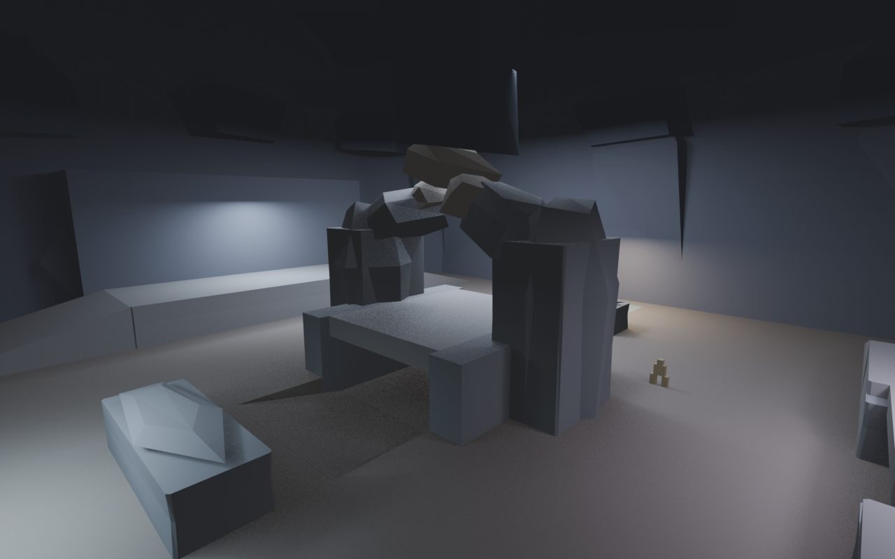
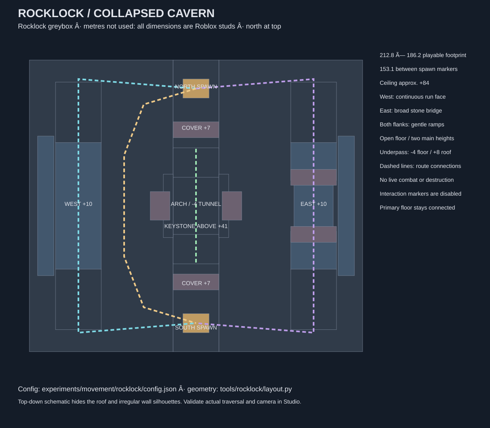

# Rocklock / Collapsed Cavern

Updated: 2026-10-30. **Confirmed:** the owner's implementation request authorizes an isolated cavern arena using the existing movement system. After seeing the first version, the owner asked for substantially more open space for gunplay and larger transformed slugs. **Implemented:** v2 replaces the dense 100 × 90 blockout with a 160 × 140 layout, removes the extra crowns, stair towers, shoulder blocks and training stones, and retains two broad flanks and one central landmark. This is an experimental map, not a final environment or combat design.

**Implemented, crystal pass:** v3 is 212.8 × 186.2 studs. Five original Blender-generated crystal designs form 16 wall, arch, ceiling and underpass clusters. Each local point light is attached to a visible crystal facet; the former floating inspection lights are removed. A cool color grade and restrained bloom give the cavern a stylized look using Roblox's built-in effects. Ambient fill remains for visibility. The gun and animation work is being developed separately and was not edited in this pass.

**Implemented, collision pass:** visible rock facets themselves collide, including the wall skins, central arch and edge formations. The old invisible skinned-box proxies do not collide, avoiding broad box-shaped barriers across the rocks' recessed areas. This uses thin triangular wedge volumes, so contact tracks the authored facets to within their thickness; it is not a mathematical zero-thickness surface and high-speed, seam and animation clipping behavior still require playtesting. Crystal facets remain noncolliding.

**Implemented, cavern art pass:** the owner approved the visual comparison recommendations and asked for stalactites. The Blender scene now has twelve hanging formations, reshaped boundary contours and central shoulders, tapered pillar skins, a blue-slate/violet palette, original procedural Blender grain, revised irregular crystal shards and the existing crystal-local lighting. Roblox uses its built-in Slate surface rather than the Blender shader. Large lanes and the 212.8 × 186.2 footprint remain. The preview also uses inspection-only fill lights; those fill lights are not in the playable place. [Establishing preview](evidence/rocklock-cavern/02-establishing.png), [player view](evidence/rocklock-cavern/03-player-centre.png), [ceiling view](evidence/rocklock-cavern/09-ceiling.png), [crystal designs](evidence/rocklock-cavern/variants.png). A Blender preview is not evidence of actual Roblox lighting.



## Open and play

From the repository root:

```powershell
.tools/blender-4.5.14-windows-x64/blender.exe --background --factory-startup --python-exit-code 1 --python tools/rocklock/crystals_blender.py
python tools/rocklock/build.py --render --private --output-suffix=-cavern4
python tools/verify_rocklock.py --output-suffix=-cavern4
```

Open **`build/SlugshotRocklockPrivate-cavern4.rbxlx`** in Studio, then press Play. It uses the owner's local private clips and blaster assets as they existed at build time. Never commit or publish this private place. Without the local private assets, omit `--private` and open **`build/SlugshotRocklock-cavern4.rbxlx`**; movement has the existing original-clip fallback.

WASD runs, double-tap W sprints, Shift slides, Ctrl toggles shift lock, Space jumps and triggers the existing traversal/double-jump actions, R resets and P changes profiles. The crystal pass does not change these controls or the camera. The separate blaster prototype is ongoing; no damage rules, rounds, slug forms or live destruction were added by this pass.

For subsequent builds with unchanged procedural inputs, use `python tools/rocklock/build.py --reuse-geometry --private --output-suffix=-cavern4`. Cached rock and crystal geometry must match their generator hashes. Use a new output suffix to preserve an open place and its unsaved session; Studio does not reload a rebuilt place. Preserve unrelated windows and unsaved work. The foundation and original movement lab are separate places. If the rock geometry cache is missing or stale, omit `--reuse-geometry` to regenerate it after checking the existing cavern source and export are safe to replace.

Optional live sync uses `rojo serve rocklock.private.project.json` on loopback **34874**, only in the Rocklock place. Regenerate after changing geometry. Never connect this project to the foundation place.

## Layout and space



| Element | v3 geometry / purpose |
| --- | --- |
| Playable starting footprint | 212.8 × 186.2 studs; 1.33 times v2 in each horizontal dimension |
| Spawn markers | North `(0, 3.15, -76.55)`, South `(0, 3.15, 76.55)`; approximately 153.10 studs apart |
| Main floor | y=0; two open lanes around the central formation, roughly 31.9 studs between the central pier and side shelf collision faces |
| West route | Shelf centred x=-76.61, y=10; roughly 29.79 studs wide; continuous wall face x=-92.57 |
| East route | Shelves and a broad natural bridge centred x=76.61, y=10; gentle ramps at both ends |
| Lower passage | About 29.79 studs wide, floor y=-4, roof underside y=8; short local bypass below the landmark |
| Landmark | Two substantial piers, fractured arch and an overhead keystone at y=41, below a fractured ceiling tongue |
| Ceiling | Approximately y=84, enclosed by visible rock and matching simple collision backing |
| Spawn cover | One broad formation near each end; both sides are open exits |

The central arch is the main silhouette and orientation point. There are no independent small obstacle-course platforms. Wide flanking shelves have ordinary ground access. Players can wall-run on continuous vertical planes, jump/climb onto the shelves, cross the central roof with advanced movement, or slide through the open lanes. The map does not require advanced techniques to reach the three primary routes.

**Considering:** larger slug bodies and ability effects should fit the open lanes, but their actual dimensions and hit rules are not defined. Space reservation is not proof that a future form or projectile will work. Tune against real representative bounding volumes once those assets exist.

**Unresolved:** v3 prioritizes the owner's spaciousness feedback over the original 100 × 90 proposal and 60–80 spawn separation. Outer sightlines can exceed 65 studs. First contact, fair high-ground access, long-range pressure and route desirability require owner playtesting with the eventual combat rules; the original 3–6 second engagement target is not established by this build.

## Reproducible geometry and collision

- [Configuration](../experiments/movement/rocklock/config.json): seed, dimensions, heights, spawn coordinates, route waypoints, palette and future interaction markers. Input X/Z coordinates use a documented 100 × 90 authoring frame. `build/rocklock/layout.json` contains final world coordinates and every collision piece.
- [Layout generator](../tools/rocklock/layout.py): one layout consumed by both Blender and Roblox; changing dimensions scales art, collision, routes and markers together. Ramp pitch is adjusted to retain its authored rise.
- [Blender generator](../tools/rocklock/blender_scene.py): original seeded layered rocks, stone skins, ceiling, columns, arch and rubble; eight inspection views; FBX export and offline reimport checks.
- [Crystal generator](../tools/rocklock/crystals_blender.py): five original faceted formations, 16 placements and an offline FBX reimport check. [Editable revised crystals](../assets/source/environment/rocklock-crystals-cavern/rocklock-crystals.blend), [FBX](../assets/exports/environment/rocklock-crystals-cavern/rocklock-crystals.fbx), and [provenance](../assets/exports/environment/rocklock-crystals-cavern/export.json) are separate from the earlier crystals and blaster assets. Regenerate crystals before building when their generator changes.
- [Place builder](../tools/rocklock/build.py): converts the exact exported triangles into thin native WedgeParts, writes an editable map model and builds the public/private Rojo places. The map is visible in Edit mode and exists before players spawn.
- [Verification](../tools/verify_rocklock.py): full movement/foundation verification plus map strict types, source fidelity, geometry integrity, wedge frames, resource budget and isolation checks.

The playable greybox uses native geometry reconstructed from Blender triangles. It has no asset IDs, mesh-upload requirement or undocumented importer step. Rock facets are anchored, collidable and queryable but nontouching; invisible blocks underlying the faceted stone skins are noncolliding and nonqueryable. Visible floor, tunnel and route pieces retain their own collision. Facets are thin wedge volumes (0.035-stud authored thickness), not uploaded triangle-mesh collision. Camera, limb and traversal contact still need human review.

Editable cavern pass: [rocklock.blend](../assets/source/environment/rocklock-cavern/rocklock.blend). Mesh-only export: [rocklock-rocks.fbx](../assets/exports/environment/rocklock-cavern/rocklock-rocks.fbx). [Export metadata](../assets/exports/environment/rocklock-cavern/export.json) records hashes, tool version, axes, units and the offline roundtrip. The Python scripts are the parameter-editable source of truth. The `.blend` preserves the full inspection scene, including crystals, inspection lighting, collision previews and an original R6-sized scale marker; the FBX contains only original rock meshes. Earlier source assets remain in their original directories.

## Optional future MeshPart import

**Confirmed documentation, not a completed Studio import:** Roblox supports FBX through its [Importer](https://create.roblox.com/docs/studio/importer). Current [export guidance](https://create.roblox.com/docs/art/modeling/export-requirements) and [mesh specifications](https://create.roblox.com/docs/art/modeling/specifications) were reviewed on 2026-10-30. Every generated rock is far below the documented 20,000-triangle per-mesh limit. No materials/textures from the references are included.

If the owner later chooses uploaded MeshParts:

1. In a disposable copy of Rocklock, use Studio **File → Import** and choose `assets/exports/environment/rocklock/rocklock-rocks.fbx`.
2. Select stud units/scale 1, preserve scene placement and inspect the preview. Export axes are FBX Y up / -Z forward; source geometry is rotated from Roblox `(X,Y,Z)` to Blender `(X,-Z,Y)`.
3. Compare the bounding dimensions and position of a named pillar against `build/rocklock/geometry.json`. Do not import the mesh set at an arbitrary pivot or rescale to fit a small default import box.
4. Mesh import may upload to the selected creator/account. Review that final import/upload action with the owner; no upload was performed for this task.
5. Set all decorative MeshParts `Anchored=true`, `CanCollide=false`, `CanTouch=false`, `CanQuery=false`; retain the existing collision folder. Replace matching named native silhouettes only after the minimal roundtrip is checked in Studio. Recheck shadows, memory, frames and both clients.

The current native conversion is the verified integration route. Blender FBX reimport verifies dimensions and object count, not Roblox importer scale, permissions or asset ownership.

## Future environmental interactions

`Workspace.Rocklock.InteractionMarkers` contains seven invisible, noncolliding markers with `InteractionId`, `Kind`, `Target`, `PreserveRoutes`, `ServerAuthoritative`, `ResetEachRound` and `Enabled=false`. They identify a keystone rockfall, two destructible covers, a temporary-barrier zone, a slowing zone, a displacement edge and an ability landing. These are metadata only.

**Considering:** a future round service would keep pristine server-owned templates and a per-round state table, validate ability ownership/cooldown/range and hits on the server, and replicate accepted changes. Reset would restore those templates and clear temporary zones and debris before respawns. The collision folder and minimum route graph should remain permanent; rockfall or cover destruction must never remove all routes between spawns. No ability remotes, round service, physics destruction or client-triggerable environment behavior were added.

## References and provenance

**Confirmed reviewed:** the owner's local `slugshot_rocklock_reference_board.html` and `Rocklock_20_Image_References.csv`. Their instructions/captions were treated as reference notes, separate from the pasted implementation request and later spaciousness correction. The board includes examples from unrelated games, stores and AI images; those are not evidence of Slugterra canon or permission to reuse art.

Three accessible images were visually inspected: the [Dark Waters cover screenshot](https://dark-waters.en.uptodown.com/android), the [RTVE series image](https://img.rtve.es/p/74752/imgportada/?w=1600), and a [cavern chamber image](https://getwallpapers.com/collection/slugterra-wallpapers). The board's Pyrite Cavern image returned HTTP 403 and was not reviewed. RTVE's linked series page redirected to its general Clan page. Borrowed only broad observations: huge rock-to-character scale, chunky angular silhouettes, cool cavern shadows, broad floor and substantial stone formations. Reference downloads/contact sheets remain ignored and are not redistributed.

**Implemented:** every deliverable rock is original procedural geometry. No third-party meshes, textures, characters or restricted movement sources were copied into the public map. See [asset register](assets.md), [architecture decision](decisions/0010-rocklock-map.md) and [actual test results](rocklock-verification.md).

## Preview views

The [five crystal designs](evidence/rocklock/crystal-variants.png) are shown in a Blender inspection render. All eight earlier rock-only Blender views are in [evidence/rocklock](evidence/rocklock/); those earlier views do not show the crystal pass. These are design inspection artifacts; Studio evidence is reported separately.
