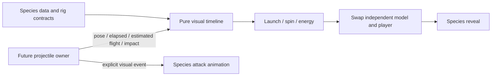

# Transformation

## Current owner direction: shared twirl and diffuse glow (2026-11-03)

**Confirmed:** "I like the initial glowing" means the gradual increase in glow; "I don't like the actual explosion itself". Keep the horizontal twirl and the transition into the bigger form. Near the floor the glow must look diffuse, not square. The shared transformation is the base for future species, with small, independent species adjustments. This supersedes revisions 1-8 below wherever they prescribe explosions, rings, extra flash, overshoot or cinders.

**Implemented; owner approval pending:** the original accelerating 1.75-turn twirl and glow buildup remain. At 0.15 s the model swaps inside the same glow; the bigger form grows smoothly from 72% to full scale over 0.1 s, unfolding over 0.13 s. The glow fades over 0.12 s without an explosion or second large flash. No shared impact ring, explosion, steam, wing halo or ember emitters remain. Inferno retains his warm colours, 2.6x flight form and authored wing/tail fire; final creature meshes are unchanged.

`TransformationStyles.DefaultMotion` and `.DefaultAura` hold the reusable defaults. Each species selects colours and form size, and can use `table.clone` on either default table to override individual motion/glow values. The sequence contains no Inferno asset dependency. New species still supply their own `<Id>Transformed` model and combat transformation timing. `TransformFold` remains the optional model-animation hook (1 closed, 0 open).

The aura uses the existing transparent radial image without world-depth clipping, with a separate camera-to-source visibility raycast so it hides behind solid walls. This is a screen-space spill, not a volume: partial cover is checked at the source centre. Do not enable the board before its image is ready. [Architecture and limits](../decisions/0028-shared-transformation-baseline.md).

**Implemented/verified offline:** `verify_combat.py` and `verify_slugs.py` pass, including foundation/movement checks, strict types and public/private builds. **Implemented/verified in one native Studio client:** `TRANSCHECK PASS`; three floor views show diffuse spill with no rectangular cutoff, a solid blocker hides the aura, the glow fades and the form reaches its final scale, wings unfold, early impact restores base scale, cancellation is idempotent, an unlanded shot expires, and a real first-person shot shows the transformed form before the server impact and leaves no transformed model. Measured impact: 60.76 studs in 0.233 s on the client; fixture wall damage is 0 (not a damage test). The range's existing `CombatSelfTest` reports `ALL PASS`. Captures and motion frames: ignored `build/transformation-check/reset-final-2026-11-03/`; pre-change source snapshot: `build/transformation-check/before-reset-2026-11-03/`. Earlier rejected captures (`reset-review` and `reset-debug`) show the loading gate failure; successful asset fetch status now gates first display instead of a disabled label's `IsLoaded`. **Unresolved:** owner acceptance, full-frame-rate motion (side capture 28 frames/3 s; first person 38/3 s), thin-cover edge transitions, multiplayer and device coverage. Studio also logged an unrelated `Redundant Flag ID: LuauIfLocal` warning; no transformation script failure in the final pass. No new source/export assets or uploads.

**Review:** [native check record](evidence/2026-11-03-transformation-reset.json). `build/SlugshotInfernoTransformationReview.rbxlx` is the clean rebuilt range, opened in its own Studio window for the owner; existing windows were preserved. Press Play, select slot 2 and fire.

## In-game transformation (2026-11-03)

**Confirmed, owner:** fired slugs spin fast, transform with a cool effect and hit in the bigger form. It must be quick but impactful, leave time to see the final form, and be reusable, with per-slug effects added on top. Floppy never transforms; Inferno is the only other slug that does so far.

**Research limit:** fan wikis confirm the rules (slugs transform at speed, Floppers never do, fire slugs become a phoenix-dragon form) but do not describe the animation, and no episodes were watched. The beats come from the owner's description. Sources: [Slugs](https://slugterra.fandom.com/wiki/Slugs), [Infurnus](https://breezewiki.discard.no/slugterra/wiki/Infurnus).

**Historical implementation (superseded by the current direction above):** [`SlugTransformation`](../../experiments/combat/client/SlugTransformation.luau) originally ran these beats:

| Real time (s) | Beat |
| --- | --- |
| 0-0.15 | Base form lies along the flight line, head first, and twirls faster and faster while shrinking to 68%; a soft glow builds around it |
| 0.15 | Flash, ring and one drawn explosion; swap to the transformed form, wings shut |
| 0.15-0.31 | The form pops out past full size, wings burst open and it rights itself to level |
| From launch | Flight starts at full speed and eases down to 40% of it |
| From the swap to the hit | It flies level, tilting a little from side to side with small wing flutters, with rippling 3D fire along the back of each wing |
| Hit | Ring and a smaller explosion; the base form returns for its landing. A shot that hits nothing does the same at 1.5 s and disappears |

**Owner revision, 2026-11-03:** "too small", "more spirally" throughout, and a trail of fire behind the final form. Inferno's flying form went from 1.5x to 2.6x (his hit size is unchanged). The spiral now runs from launch to hit: ribbons while slow, then flames laid in a double helix around a fire core. A ribbon gets one point per frame, and at full speed a frame is about 8 studs, which turned it into a zigzag. Each flame has its own emitter, because several Emits from one emitter in a frame all landed in one spot.

**Owner revision 2, 2026-11-03:** the base form must twirl lying horizontal, not standing. The drawn swirl round it looked like "an AI slop drawing" and is removed. The charge glow was "too circular and spherical" and hard: it now uses the soft UI glow image, whose falloff reaches nothing before its edge, instead of stacked circles. After the swap the form stays straight, with a slight tilt and wing flutter, and the spiral fire is replaced by a straight trail. The glow around the tail flame is off in flight, though the flame in the mesh and the outline stay; the display model keeps its glow. **This supersedes the spiral in the earlier revision.**

**Owner revision 3, 2026-11-03:** make the fire "more cartoony slash comic-y". The trail and the swap and hit bursts now use original inked flipbooks with hard colour bands (since replaced; see revisions 5 and 6), drawn flat with no lighting. Particle `VelocityParallel` lines the image width up with travel, so the sprites are rotated -90 degrees to run their tips along it.

**Owner revision 4, 2026-11-03:** not "loads of individual different fireballs": one flame stream, tips back, horizontal, not left behind on the map. Particles are replaced by Beams carrying a looping eight-frame drawing of one long flame. The owner suggested fixing it to the wings, so there is one per wing and the tail keeps only the flame in its mesh. Flight must be fastest at launch and then slow, and unlanded shots must despawn: see [ADR 0023](../decisions/0027-transformation-flight-timing.md). Beam lessons: they scroll unless `TextureSpeed` is 0, and draw a white box for an image that has not been preloaded as a Beam. **This supersedes the trail in the earlier revisions.**

**Owner revision 5, 2026-11-03 (explosion superseded by revision 6):** the burst was "a bunch of fireballs exploding", and it "needs to be one explosion". Particle bursts are gone: a drawn flipbook played one explosion that bursts open and burns out from the middle, played from a sheet on a billboard. The wing flames looked "stuck on", "slapped on vertically" and too flat at range; they should be "horizontal", "stick to the wings", span "almost the full wing" and have "a slight 3D effect" and a ripple. Beams cannot do this, so `tools/slugs/build_wing_fire.py` builds real geometry along each wing's back edge, rooted under the wing, on bones matching the dragon's. It is a separate model that the server clips on to the flying dragon only, so the approved dragon model and the display place are unchanged. `InfernoMotion` runs the ripple. **This supersedes the wing streams in revision 4.**

**Owner revision 6, 2026-11-03:** the drawn explosion was liked but "too choppy" and flat: "it needs to be 3D". The wing fire's attachment, thickness and design were liked, but it looked "like skin", needed a trail "so it looks more flowy", "sparkles or cinders" and "diffusing into the air", and should reach "a bit further back". Now: one 3D explosion mesh (`build_wing_fire.py --explosion`) that bursts out, swells and shrinks away each frame, so it can't be choppy. Its drawn bands are a pale core inside rim shells offset straight out from the centre and turned inside out, so from any side they show only round its edge, as the drawing's bands did. The wing fire glows (an emissive mask), its tips fade out raggedly through alpha, it is 15% longer, and a faint short trail plus small embers come off its outer edge. Assets: `tools/slugs/upload_fire_effects.py`.

**Owner revision 7, 2026-11-03:** the trail sheet read as an "orange box"; cinders looked like "diffused orange spots", then "horrible" as Roblox's star sparkles; the wing fire must be "the same length" along the wing and keep the "older look" without extra points; the explosion was "too chunky, too blocky" and should "look more alive" and blend into the scene. Now: no trail sheet, a soft glow and light round each wing's fire instead; cinders are a drawn comic ember that streaks along its travel and flickers as it dies; the wing fire is an even length with solid, smooth licks (fading the tips washed them pale and the outline stepped round the fade); the explosion has 22 slimmer points and thinner bands, a soft glow, a flash of light on its surroundings and a burst of embers.

Shots that would hit before the swap can happen run the sequence faster, so the swap falls at 55% of the time available. That check uses the path at launch and is visual only; a moving target can still be hit before the swap, and the hit then just ends the sequence.

**Adding a slug:** add a `Transformation` table to its `Combat.Slugs` entry, a `<Id>Transformed` model to `CombatAssets`, and an entry in [`TransformationStyles`](../../experiments/combat/client/TransformationStyles.luau) for colours, flight size and optional cloned motion/aura defaults. Fire or other effects carried by the form belong in its model. Without a style it gets the neutral shared palette. The model's own motion script can read `TransformFold` (1 shut, 0 open) for wings or equivalent. No explosion drawing is required.

**Considering:** Inferno's numbers (timings, 2.6x flight size, glow, fire and explosion sizes) are first proposals for the owner's playtest.

**Slow motion (Studio):** P panel, *Slow motion (review)* → *Shot speed*, from 1 (real) down to 0.05. It slows flight, spin, rings, the explosion and the dragon's motion on this screen only, from the next shot. While it is below 1 the client ignores the server's hit message, which still arrives at real speed, and lands the shot from its own sweep; damage is unchanged. Landing recovery stays at real speed.

Review with `python tools/build_transformation_check.py` and `tools/studio/transformation_check.ps1 -OutDir <folder>`. The older interface below belongs to the creature preview lab; combat does not use it.

# Transformation presentation interface

**Confirmed:** transformation staging is configurable infrastructure. Combat, projectile simulation, collision, damage, networking and weapon rules remain outside this implementation. No final species or timing has been selected. [Visual module](../../experiments/creatures/client/Visual.luau), [pure timeline](../../experiments/creatures/shared/Timeline.luau).



## Time and stages

Launch occupies the first 15% of the visual sequence, spin the next 20%, then energy buildup runs until the configured transition fraction. At transition the small rig is hidden and the independent transformed rig appears. Reveal progresses until completion; the reveal stage label begins at `revealFraction`. These are editable technical defaults, not artistic commitments. The `spinTurnsPerSecond`, effect reference/color and total duration belong to the species profile.

Visual duration is `min(profile.duration, estimatedFlightSeconds)`. A future projectile owner can estimate flight seconds as distance/speed, or provide a better prediction. At 300–400 studs/s a 20-stud shot has only 0.05–0.067 s; the 0.06 s lab case exercises this constraint. An explicit impact signal immediately returns complete visual progress, independently of predicted time. Zero-distance flight completes immediately. A changed estimate cannot reverse a completed rig swap: progress is monotonic within a handle. The caller supplies a **total elapsed-plus-remaining estimate**, not just remaining time.

Long shots can reveal during flight; close shots may skip most intermediate frames. Impact can finish the visual at the actual hit position. No task wait, animation-ended callback, cast, velocity control or damage call is used in this path. The future gameplay owner chooses the impact lifecycle and cleanup time; presentation never tells gameplay when a hit is valid.

## Runtime API

Create a handle once, feed it once per simulation frame, and destroy it on cancellation or completion. For a flight:

```lua
local handle = Visual.new(speciesId, {
	parent = workspace.CreatureVisuals,
	resolveModel = resolveLocalTemplate, -- returns a template; the renderer clones it
	animationIds = privateBindings,
	onEffect = updateSpeciesEffect,
	onDeform = updateVerifiedSkinDeformation,
	scale = 1,
	orientation = CFrame.identity,
})
-- The caller alone owns projectile position and collision.
local sample = handle:update(projectileCFrame, elapsed, elapsed + estimatedRemaining, impacted)
-- Only an explicit gameplay visual event requests the attack animation.
handle:playAttack()
handle:destroy()
```

`resolveModel(formName, formDefinition)` supplies local imported templates with `RigId` and a PrimaryPart at their export origin. The renderer supports independent protoform/transformed rigs. AnimationController/Animator playback uses form-specific bindings and checks the declared rig before loading. Load errors warn; a missing binding returns false rather than inventing an ID. `idle(pose, elapsed)` previews a stationary protoform without running its flight timeline. Each handle owns its cloned models, animation instances and tracks; destruction is idempotent. Caller-owned effects must clean up in their own handle lifecycle.

The default provider is the labeled native Parts/Motor6D fixture. It requires `placeholder: true`; real art must supply a resolver. Native rigs use the same names and hierarchy contract but are only playback/transition proxies. Imported Bone rigs get sockets attached in the bone's rest coordinate frame. Source export/import and engine deformation still need their own gate.

The timeline returns `stage`, normalized progress, transformed state, spin radians, squash amount, energy envelope and reveal fraction. Effects consume these parameters. Native fixtures implement volume-preserving squash by resizing their Parts and joint/socket offsets; imported rigs can use `onDeform` after verifying their deformation route. The lab uses a simple Highlight as a temporary energy indicator. It does not author a production particle library.

Imported launch/preparation/reveal clips are sampled by normalized phase so short flights do not wait for a one-second clip. Spin repeats; effect rotation also uses elapsed time and configured speed. `playSlot(slot)` explicitly plays or restarts any declared form slot, including expressions, impact or recovery, and holds automatic slot selection until `resumeSequence()`. An explicit attack plays at its own speed and is not forced by the transformation timeline. Model replacement is a hard visibility swap in v1. The callback/independent-model boundary permits future concealment, crossfade or different reveal geometry without requiring common skeletons. Literal cross-rig morphing and production effects are not implemented.

## Debugging

In the [preview lab](studio-import.md), `1` uses 0.06 s and `2` uses 0.8 s; `I` forces impact early; `A` requests an attack visual after transformation; `R` recreates the idle fixture. The HUD reports stage. Use the browser frame slider to inspect the source preview around the transition fraction. Inspect `export-report.json` for skeleton/action mismatches; inspect Studio Output for missing bindings or import/permission errors. The lab holds position deliberately: it tests visual timing without inventing projectile physics or speed rules.

**Owner revision 8, 2026-11-03:** the explosion should not "boom then collapse inwards"; it should "dissipate out" into the environment like a fire being put out or a hot pan put in water. It now bursts out, then keeps spreading (to about 1.9x) while it thins and cools, still glowing as it goes. It leaves a soft steam haze, lit by the scene, that drifts up and fades about 0.3 s later. Verified in a slowed Studio sequence (the `boom-*` shots in the transformation check). **Unresolved:** owner verdict at full speed.
