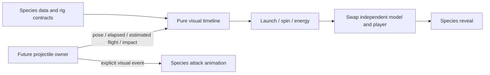

# Transformation presentation interface

**Confirmed:** transformation staging is configurable infrastructure. Combat, projectile simulation, collision, damage, networking and weapon rules remain outside this implementation. No final species or timing has been selected. [Visual module](../../experiments/creatures/client/Visual.luau), [pure timeline](../../experiments/creatures/shared/Timeline.luau).



## Time and stages

Launch occupies the first 15% of the visual sequence, spin the next 20%, then energy buildup runs until the configured transition fraction. At transition the small rig is hidden and the independent transformed rig appears. Reveal progresses until completion; the reveal stage label begins at `revealFraction`. These are editable technical defaults, not artistic commitments. The `spinTurnsPerSecond`, effect reference/color and total duration belong to the species profile.

Visual duration is `min(profile.duration, estimatedFlightSeconds)`. A future projectile owner can estimate flight seconds as distance/speed, or provide a better prediction. At 300–400 studs/s a 20-stud shot has only 0.05–0.067 s; the 0.06 s lab case exercises this constraint. An explicit impact signal immediately returns complete visual progress, independently of predicted time. Zero-distance flight completes immediately. A changed estimate cannot reverse a completed rig swap: progress is monotonic within a handle. The caller supplies a **total elapsed-plus-remaining estimate**, not just remaining time.

Long shots can reveal during flight; close shots may skip most intermediate frames. Impact can finish the visual at the actual hit position. No task wait, animation-ended callback, cast, velocity control or damage call is used in this path. The future gameplay owner chooses the impact lifecycle and cleanup time; presentation never tells gameplay when a hit is valid.

## Runtime API

Create a handle once, feed it once per simulation frame, and destroy it on cancellation or completion. For a flight:

```lua
local handle = Visual.new(speciesId, {
	parent = workspace.CreatureVisuals,
	resolveModel = resolveLocalTemplate, -- returns a template; the renderer clones it
	animationIds = privateBindings,
	onEffect = updateSpeciesEffect,
	onDeform = updateVerifiedSkinDeformation,
	scale = 1,
	orientation = CFrame.identity,
})
-- The caller alone owns projectile position and collision.
local sample = handle:update(projectileCFrame, elapsed, elapsed + estimatedRemaining, impacted)
-- Only an explicit gameplay visual event requests the attack animation.
handle:playAttack()
handle:destroy()
```

`resolveModel(formName, formDefinition)` supplies local imported templates with `RigId` and a PrimaryPart at their export origin. The renderer supports independent protoform/transformed rigs. AnimationController/Animator playback uses form-specific bindings and checks the declared rig before loading. Load errors warn; a missing binding returns false rather than inventing an ID. `idle(pose, elapsed)` previews a stationary protoform without running its flight timeline. Each handle owns its cloned models, animation instances and tracks; destruction is idempotent. Caller-owned effects must clean up in their own handle lifecycle.

The default provider is the labeled native Parts/Motor6D fixture. It requires `placeholder: true`; real art must supply a resolver. Native rigs use the same names and hierarchy contract but are only playback/transition proxies. Imported Bone rigs get sockets attached in the bone's rest coordinate frame. Source export/import and engine deformation still need their own gate.

The timeline returns `stage`, normalized progress, transformed state, spin radians, squash amount, energy envelope and reveal fraction. Effects consume these parameters. Native fixtures implement volume-preserving squash by resizing their Parts and joint/socket offsets; imported rigs can use `onDeform` after verifying their deformation route. The lab uses a simple Highlight as a temporary energy indicator. It does not author a production particle library.

Imported launch/preparation/reveal clips are sampled by normalized phase so short flights do not wait for a one-second clip. Spin repeats; effect rotation also uses elapsed time and configured speed. `playSlot(slot)` explicitly plays or restarts any declared form slot, including expressions, impact or recovery, and holds automatic slot selection until `resumeSequence()`. An explicit attack plays at its own speed and is not forced by the transformation timeline. Model replacement is a hard visibility swap in v1. The callback/independent-model boundary permits future concealment, crossfade or different reveal geometry without requiring common skeletons. Literal cross-rig morphing and production effects are not implemented.

## Debugging

In the [preview lab](studio-import.md), `1` uses 0.06 s and `2` uses 0.8 s; `I` forces impact early; `A` requests an attack visual after transformation; `R` recreates the idle fixture. The HUD reports stage. Use the browser frame slider to inspect the source preview around the transition fraction. Inspect `export-report.json` for skeleton/action mismatches; inspect Studio Output for missing bindings or import/permission errors. The lab holds position deliberately: it tests visual timing without inventing projectile physics or speed rules.
